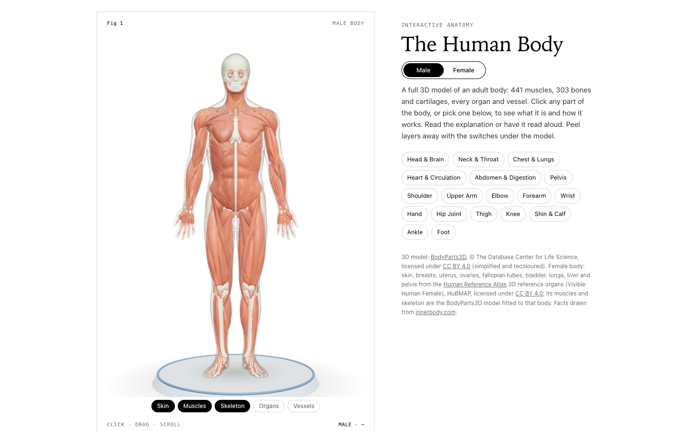
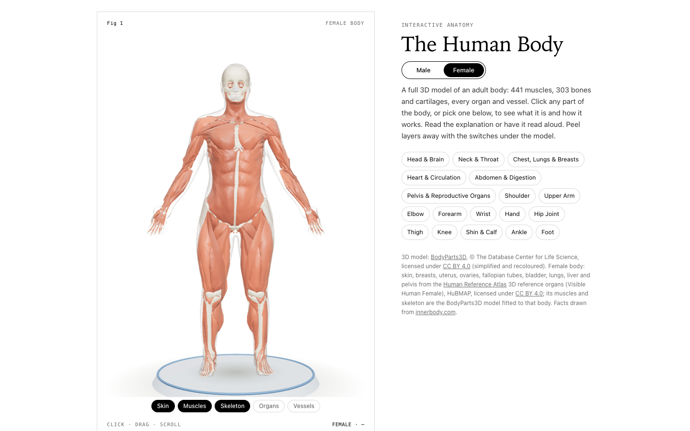
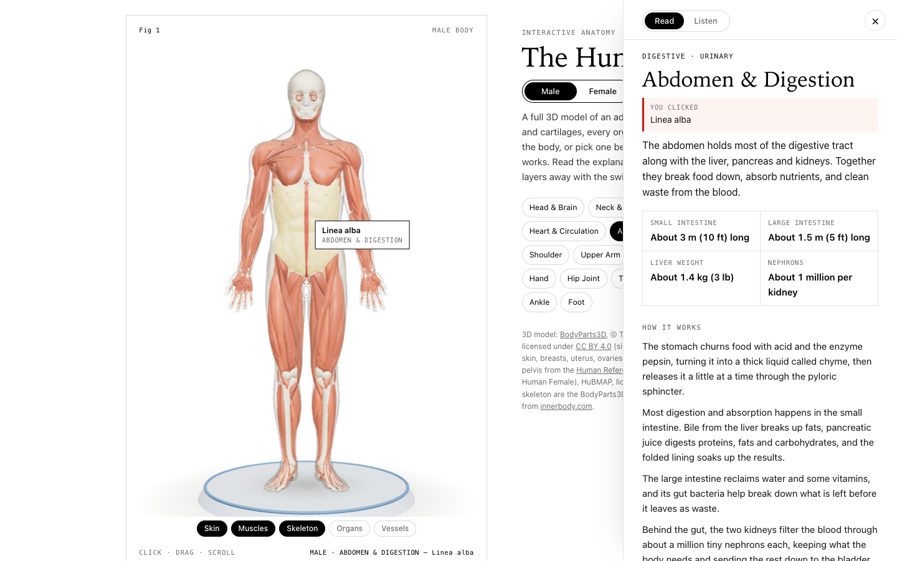
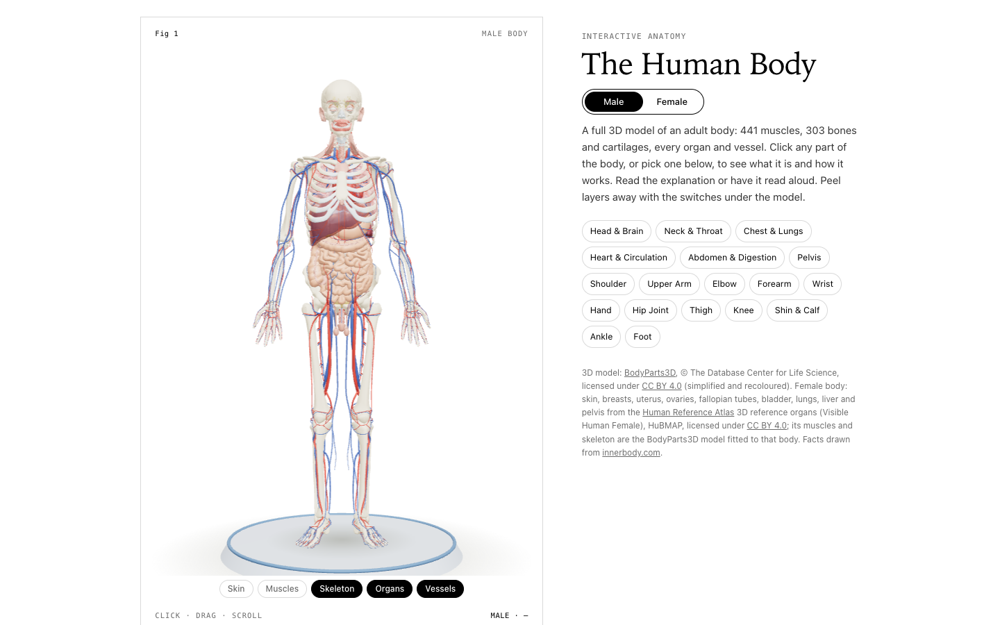

# humanbody-anatomy

A single-page interactive 3D anatomy model. A full adult body, male or female, stands on a display stand: 441 muscles, 303 bones and cartilages, the organs and vessels.

- **Moving around:** all by mouse. Drag left/right to turn the body, drag up/down to move the view along it, and scroll to zoom. The arrow keys do the same.
- **Hover and click:** hover a part to see its exact name. Click it and that region turns light yellow, the clicked structure turns red, and a side panel explains how it works.
- **Read or Listen:** the panel has two tabs. Listen reads the panel aloud, block by block, and marks the current word. There are two voices, Google UK English Female and Male (in Chrome; other browsers get their closest English female and male voices), and four speeds.
- **Layers:** switches under the model peel away the skin, muscles, skeleton, organs and vessels.

Built with [Anatomy](https://github.com/wheresryan22/anatomy), the Claude skill for crafted, interactive figures. The first version (in `legacy-iso/`) is an Anatomy isometric figure, and the current one keeps its figure card (Fig 1, title, hint, live readout) and is checked with its headless-Chrome scripts (`legacy-iso/scripts/drive.mjs`).

## Preview

| Male | Female |
| --- | --- |
|  |  |
| **Click a part to read about it** | **Peel away the layers** |
|  |  |

## Run

```sh
npm install
npm run dev        # http://localhost:5173
npm run build      # static site in dist/ (deploy anywhere)
SITE_URL=https://your.site npm run build  # same, with an absolute og:image URL for social cards
npm run typecheck  # TypeScript, for the app (src/) and the model tools (tools/)
```

## How it's built

- `tools/classify.ts` reads the 2,234 BodyParts3D meshes and sorts each one into a layer (muscle, bone, organ, vessel, skin) using the FMA IS-A categories.
- `tools/build-model.ts` gives every mesh a clickable region. It uses name rules first and falls back to the distance from body segments anchored on the real bones. Each mesh is then simplified with meshoptimizer, given atlas colours, and merged per layer × region. The merged meshes keep a structure-name table, so a click names the exact structure.
  - BodyParts3D has no lung or liver tissue meshes in the male body, only their airways, ducts and vessels. Their surfaces are derived from those trees (distance field → closing → marching cubes → smoothing) and drawn translucent.
- **The female body** (`--female`, `tools/female.ts`). BodyParts3D is male only, so the female body takes the Visible Human Female from the HuBMAP Human Reference Atlas:
  - **From the atlas:** the skin, breasts (fat, mammary lobes, ducts, nipple), uterus, ovaries, fallopian tubes, bladder, lungs, liver and bony pelvis, plus the uterine vessels.
  - **Muscles and skeleton:** the BodyParts3D ones, fitted into that body in two thin-plate-spline passes:
    1. **Bones.** Thighs and shins go onto the atlas femurs and tibias, the spine disc by disc, and the pelvis by its landmarks. The feet are matched by heel, toe and ankle; the arms by a rotation about the shoulder to the female arm line, with each hand pinned bone by bone as one rigid piece and its fingers and thumb drawn together (the atlas woman's hands are fanned wide); the head by a similarity.
    2. **Skin.** The surface is pulled onto the female skin. Muscles follow only 40% of an outward pull, since that difference is mostly fat.
  - **Removed:** the male reproductive organs.
- `src/main.ts` holds the Three.js viewer:
  - picking (three-mesh-bvh) and the hover tooltip
  - the highlight: a per-vertex structure number compared in the shader
  - the layer switches and the male/female switch, which loads each GLB on first use behind a skeleton figure
  - mouse drag: sideways turns the body, up/down moves the view; zooming to the cursor can slide the view sideways only when close in, and zooming back out re-centres the body
- `src/ui.tsx` mounts [shadcn/ui](https://ui.shadcn.com) components (Base UI, Tailwind v4, `src/components/ui/`) into the page as small React islands. The panel scrolls in a ScrollArea, which replaces the native scrollbar with a thin thumb shown on hover. The voice and speed pickers are Selects, and the loading placeholder is a standing figure made of Skeletons.
- `src/listen.ts` is read-aloud on the browser's speech engine through [easy-speech](https://github.com/jankapunkt/easy-speech): two voices and speed choice, block highlight, word marking with the CSS Custom Highlight API, and click-a-block-to-jump.
- `src/content.ts` holds the panel text for 18 regions, written from innerbody.com. The chest and pelvis have female versions.
- `legacy-iso/` holds the first version, an isometric mannequin built with the [Anatomy](https://github.com/wheresryan22/anatomy) skill kit.

## Credits

- 3D model: **BodyParts3D, © The Database Center for Life Science licensed under CC Attribution 4.0 International** (https://dbarchive.biosciencedbc.jp/en/bodyparts3d/). Adapted: simplified, recoloured, axes converted, lung and liver surfaces derived, and refitted for the female body.
- Female skin, breasts, reproductive organs, bladder, lungs, liver and pelvis: **Human Reference Atlas 3D reference organs (Visible Human Female), HuBMAP, CC BY 4.0** (https://humanatlas.io/3d-reference-library). Adapted: simplified and recoloured.
- Facts: https://www.innerbody.com/htm/body.html
- Built with Anatomy: https://github.com/wheresryan22/anatomy
